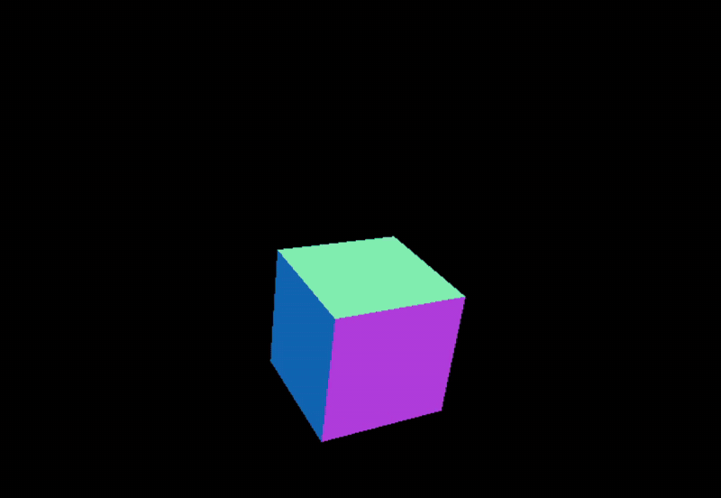
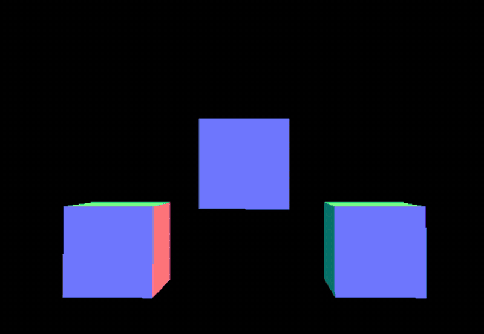

<div align="center">

# ThreeJsStudio

Una raccolta di piccoli esperimenti con **Three.js** per studiare le basi della grafica 3D sul web: scene, mesh, gruppi, trasformazioni e animazioni.


</div>

---

## Progetti

| Progetto | Concetti principali |
| --- | --- |
| [animationCube](#animationcube) | Mesh, `Timer`, animation loop, rotazione e oscillazione |
| [positionAndGroups](#positionandgroups) | `clone()`, posizionamento, `THREE.Group`, animazione dei figli |

---

### animationCube

<p align="center">
  
</p>

Un singolo cubo con `MeshNormalMaterial` che ruota sugli assi X e Y e oscilla verticalmente.

- **`THREE.Timer`** per ottenere tempo trascorso (`getElapsed`) e delta tra i frame (`getDelta`)
- **Oscillazione** sull'asse Y con `Math.sin(elapsedTime * velCube)`
- **Rotazione** continua con `rotateX` / `rotateY` basata sul delta time
- **Render loop** gestito con `requestAnimationFrame`

📁 [`animationCube/vite-project/src/main.js`](animationCube/vite-project/src/main.js)

---

### positionAndGroups

<p align="center">
  
</p>

Tre cubi clonati da una stessa mesh, posizionati lungo l'asse X e raggruppati in un `THREE.Group`.

- **`mesh.clone()`** per riutilizzare geometria e materiale
- **`THREE.Group`** per spostare più oggetti come un'unica entità
- **`groupRotate()`** ruota ogni figlio del gruppo con `forEach`
- **`fluidCube()`** fa oscillare solo i cubi laterali con `children.slice(1, 3)`

📁 [`positionAndGroups/vite-project/src/main.js`](positionAndGroups/vite-project/src/main.js)

---

## Avvio rapido

**Requisiti:** Node.js 18+ e npm

```bash
git clone https://github.com/42Paolo/ThreeJSProjects.git
cd ThreeJSProjects/<nome-progetto>/vite-project
npm install
npm run dev
```

Poi apri l'indirizzo mostrato nel terminale (di default `http://localhost:5173`).

| Comando | Descrizione |
| --- | --- |
| `npm run dev` | Avvia il server di sviluppo |
| `npm run build` | Crea la build di produzione |
| `npm run preview` | Anteprima della build |

## Struttura

```
ThreeJsStudio/
├── GIFAnimation/          # GIF delle demo
├── animationCube/
│   └── vite-project/
│       └── src/main.js
└── positionAndGroups/
    └── vite-project/
        └── src/main.js
```

## Licenza

Distribuito con licenza [MIT](animationCube/LICENSE).
